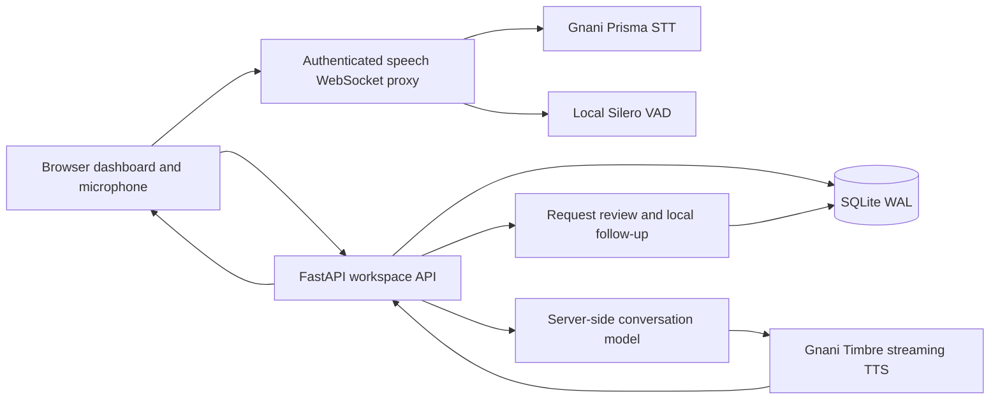

<p align="center">
  
</p>

<h1 align="center">Relay Voice</h1>

<p align="center">Configurable AI voice conversations for sales, customer help, customer care and appointment intake.</p>

<p align="center">
  <a href="https://github.com/solmyst/calling-sas/actions/workflows/ci.yml"></a>
  <a href="https://solmyst.github.io/calling-sas/">Product website</a> ·
  <a href="#quick-start">Run locally</a> ·
  <a href="#demo-walkthrough">Demo walkthrough</a> ·
  <a href="video/README.md">Hackathon video</a>
</p>

Relay Voice combines a business dashboard with a working browser voice pipeline. Configure an agent's instructions and business context, talk through a scenario, interrupt naturally, correct a detail, and review the saved conversation when needed.

The application uses **FastAPI, SQLite and buildless JavaScript**, with **Gnani Prisma STT, Gnani Timbre TTS and a server-side conversation model**. Silero VAD supports automatic interruption. Speech and model API keys stay on the backend.

> **Current scope:** a single-workspace browser voice demo. Real telephone calls, calendar bookings, external CRM updates and message delivery are disabled. Local follow-up records are explicitly labelled. This is not yet a multi-tenant production calling service.

## Four demo experiences

| Experience | What the agent does | Current result |
|---|---|---|
| Sales consultant | Discovers the business need, qualifies interest and discusses a bounded pilot | Transcript and next-step request |
| Business helper | Answers questions using approved business information in the configured language | Answer or team follow-up request |
| Customer care | Understands an issue, suggests approved troubleshooting and captures escalation needs | Support transcript and human-review request |
| Appointment concierge | Collects a service, preferred day and time, and reads back corrections | Appointment request awaiting availability verification |

English, Hindi and Hinglish are configurable. Account connectivity and synthetic speech have been exercised; accents, noisy rooms, speaker echo and perceived voice quality still need evaluation on the actual demo device. See [voice validation](docs/GNANI-VALIDATION.md).

## Features

- **Configurable agents:** business facts, system instructions, opening, use case, language, delivery and active/paused status.
- **Hands-free browser voice:** streaming recognition, streamed audio playback, automatic barge-in, and browser echo-cancellation/noise-suppression requests.
- **Conversation memory:** persistent customer notes, latest-correction instructions and interruption-aware model history, scoped to one conversation.
- **Contacts:** search, segments, E.164 validation, consent flags and do-not-call enforcement.
- **Call history:** saved transcripts, configuration snapshots, export and resumption of active sessions.
- **Optional request review:** evidence-backed AI suggestions, manual corrections, assigned owners, revision checks and a request activity trail.
- **Local follow-up:** deduplicated workspace-local lead and task records after operator review.
- **Workflow rehearsal:** manually run, labelled batch simulations with request deduplication.
- **Dashboard and analytics:** metrics derived from stored sessions and simulations, rather than fabricated production results.
- **Operations:** hosted-mode configuration checks, optional local password, backup utility, systemd/reverse-proxy/container templates and CI tests.

Ending a call keeps **Call Studio visible**. Conversation Details opens only when selected; there is no automatic post-call popup.

## Visual theme

The dashboard and marketing site use **oatmeal `#E8DCC6`**, **pine green `#1F3B2E`** and **soft lilac `#CBB3E8`**. Warm surfaces, pine navigation and lilac accents share CSS tokens in [`static/style.css`](static/style.css) and [`site/style.css`](site/style.css); semantic error states remain distinct.

## Quick start

### Requirements

- macOS or Linux with Python and `venv`. Python **3.12 is exercised in CI**; local development has also used Python **3.14**.
- A current browser with a microphone for live voice. Hosted microphone access requires HTTPS; loopback is suitable for local development.
- Approved speech/model accounts and network access for live AI conversations.
- Node.js **22+** only for JavaScript tests and optional video/browser tooling. Running the application needs no frontend build, Docker or telephone account.

```sh
git clone https://github.com/solmyst/calling-sas.git
cd calling-sas
python3 -m venv .venv
.venv/bin/python -m pip install -r requirements.lock
cp .env.example .env
./scripts/start.sh
```

For an existing checkout, preserve your configured `.env` instead of copying over it. Open **http://127.0.0.1:8787/#demos** and stop the server with `Ctrl+C`. Typed simulation works with the example configuration and no API credentials; live browser voice stays unavailable until configured.

The start script installs the lockfile automatically if `.venv` is absent. To update an existing environment after dependency changes, run the explicit `pip install` command above.

If port 8787 is already occupied, use another port and matching origin:

```sh
PORT=8794 PUBLIC_ORIGIN=http://127.0.0.1:8794 ./scripts/start.sh
```

Open **http://127.0.0.1:8794/#demos** in that case. Local mode binds to loopback; leave unrelated services running.

## Configuration

Use the root `.env` for local settings. It is Git-ignored. Shell environment variables take precedence. Restart the backend after changing provider configuration.

### Live voice with Gnani

```dotenv
SPEECH_PROVIDER=gnani
GNANI_API_KEY=
GNANI_STT_MODEL=prisma-v3.0
GNANI_TTS_MODEL=timbre-v3.0
GNANI_VOICE=Shivani
GNANI_SILENCE_MS=600
GNANI_SPEED=1.0
GNANI_AUDIO_TAGS=false

# Set the endpoint and model authorized for your own gateway account.
BIFROST_URL=
BIFROST_VK=
BIFROST_MODELS=
```

| Setting | Purpose |
|---|---|
| `SPEECH_PROVIDER` | `gnani` selects the Gnani speech adapters; `legacy` selects the AssemblyAI/ElevenLabs path |
| `GNANI_API_KEY` | Server-side speech recognition and synthesis authentication |
| `GNANI_STT_MODEL`, `GNANI_TTS_MODEL` | Speech model IDs supported by the account |
| `GNANI_VOICE` | A voice compatible with the selected TTS model; currently configured server-wide |
| `GNANI_SILENCE_MS` | Recognition endpointing setting; tune through evaluation rather than assuming lower is better |
| `GNANI_SPEED`, `GNANI_AUDIO_TAGS` | Synthesis speed and optional delivery tags |
| `BIFROST_URL`, `BIFROST_VK`, `BIFROST_MODELS` | Approved conversation gateway URL, virtual key and model ID; also used for optional request extraction |
| `PORT`, `PUBLIC_ORIGIN` | Listening port and exact browser origin; change them together |
| `DATABASE_PATH` | SQLite file; defaults to `runtime/relay.sqlite` |
| `DEMO_PASSWORD` | Optional shared workspace password locally; required in hosted mode |
| `SESSION_SECRET` | Session-signing secret; required in hosted mode |
| `APP_ENV`, `HOST` | Local/hosted behavior and bind address; see deployment documentation |

The legacy speech path uses `ASSEMBLYAI_API_KEY`, `ELEVENLABS_API_KEY`, `ELEVENLABS_VOICE_ID` and `ELEVENLABS_MODEL`, alongside the same conversation gateway. Selecting Gnani never silently falls back to another paid speech provider. See [.env.example](.env.example) and [detailed Gnani setup](docs/GNANI-DEMO.md).

Speech, model and optional extraction requests can incur provider charges. No API credits, provider account rights or production capacity are included with the repository. Manual request entry and typed simulation do not need model credentials.

## Demo walkthrough

1. Open **Demo experiences** and choose one of the four flows.
2. Customize the agent's language, instructions and approved business context.
3. In **Call Studio**, select **Live browser voice**, start and grant microphone access. Typed simulation is available separately.
4. Speak while the AI is talking to interrupt it. Try a correction such as “Actually, Saturday at two instead.”
5. End the session. The studio stays on the completed conversation.
6. When useful, open its details from **Call History**. Extract customer preferences or enter them manually, inspect the supporting customer statements, and save a reviewed request with an owner.
7. Create a **local follow-up**. This saves a lead and task in the workspace; it does not confirm availability or contact an external system.

Suggested pitch: demonstrate one relevant workflow, an unexpected question, a correction, and the saved next step. Agree on an outcome a future pilot can measure. Avoid presenting a browser conversation as a telephone call or a booking request as a confirmed appointment.

## Calling modes and boundaries

| Mode or action | Implemented behavior |
|---|---|
| Typed simulation | Scripted offline conversation; no speech/model API requests |
| Live browser voice | Actual configured STT → model → TTS pipeline using the computer microphone and speakers |
| Workflow run | Manual batch of scripted simulations; no scheduled phone campaign |
| Request extraction | Optional paid post-call model request with validated customer evidence; suggestions require operator review |
| Local follow-up | Persisted workspace-local lead/task; repeated saves reuse the same records |
| Telephone calling | Rejected by the backend; no carrier adapter is installed |
| Calendar/CRM/messaging | External actions disabled; no booking, CRM sync, transfer, SMS, email or WhatsApp delivery |

Business outcomes and connection/session status are different. Browser sessions are saved conservatively for follow-up, handoff or opt-out; simulated positive outcomes do not prove production conversions.

## Architecture



The browser sends 16 kHz PCM; Gnani synthesis is streamed back as 24 kHz PCM. The current response path waits for the model's complete answer before starting TTS. Server first-audio timings exclude endpointing and downstream playback, so they are not an end-to-end latency SLA.

| Location | Responsibility |
|---|---|
| `app/main.py` | App factory, input models, authentication boundaries, call lifecycle and voice routes |
| `app/gnani.py`, `app/voice.py`, `app/vad.py` | Speech/model adapters and local VAD |
| `app/memory.py`, `app/requests.py` | Conversation memory, grounded extraction, request review and local follow-up |
| `app/store.py`, `app/engine.py`, `app/seed.py` | SQLite transactions, offline simulation and minimal demo configuration |
| `static/` | Dashboard, forms, browser audio capture/playback and request-review UI |
| `site/` | Independent public marketing website |
| `tests/`, `scripts/` | Regression checks, validation helpers, startup and backups |
| `deploy/`, `video/` | VM templates and the separate film-rendering pipeline |

## Data and security

- Provider credentials stay in server-side configuration. Never place keys in `static/`, `site/`, screenshots, logs or commits.
- `runtime/` and SQLite files are ignored by Git. Keep them and their backups private; they can contain contacts, transcripts and request details.
- Ordinary browser sessions save transcript text, not raw microphone recordings. Explicit validation/video tools can write synthetic or recording media to their ignored output directories.
- Memory is scoped to one conversation. A new session does not automatically import another customer's history.
- Redaction is a defensive filter, not a guarantee that all personal information is removed. Demo contacts should use fictional information.
- Consent flags and suppression checks exist; a production consent-evidence ledger is still required.
- Hosted mode requires HTTPS, a password of at least 16 characters and an explicitly configured session secret of at least 32 characters. Shared-password access is not user accounts, roles or tenant isolation.
- Run one application worker for the current single-workspace design. Review the [deployment limitations](docs/DEPLOYMENT.md) before hosting customer data.

Use the backup utility for a live SQLite database; do not copy an active database/WAL pair as a backup strategy. See [backup and restore instructions](docs/DEPLOYMENT.md#backups-and-restore).

## Testing and verification

From the repository root:

```sh
.venv/bin/python -m unittest discover -s tests -v
node --check static/app.js
node --check static/views.js
node --check static/forms.js
node --check static/voice-session.js
node --check static/request-review.js
node --test tests/*.test.mjs
node --test video/scripts/motion.test.mjs
```

These checks use temporary databases and mocked provider boundaries; no paid API requests or real calls are made. CI runs the Python suite, application JavaScript checks and video-motion tests.

The optional real-browser request-review check uses the existing video toolchain's Playwright installation and an installed Google Chrome, or a compatible `BROWSER_PATH`:

```sh
(cd video && npm ci)
node scripts/check_request_browser.mjs
# Opt into a paid extraction using fictional customer statements:
node scripts/check_request_browser.mjs --live-model
```

The helper uses its own loopback server and temporary database. Additional provider/audio checks are documented in [Gnani setup](docs/GNANI-DEMO.md), [barge-in and memory](docs/BARGE-IN-MEMORY.md), and [request review](docs/REQUEST-REVIEW.md). Physical microphone permissions, acoustics, language quality, carrier audio and production load need separate evaluation.

## Website and deployment

The [GitHub Pages website](https://solmyst.github.io/calling-sas/) is deployed from `site/`. **GitHub Pages hosts the marketing site only**: it cannot run FastAPI, private API keys, SQLite or the server-side speech connections.

The voice application has a separate authenticated Azure VM demo. The 28 October deployment/provider checks are recorded in [Gnani validation](docs/GNANI-VALIDATION.md). Later request-review and studio-popup changes have been verified locally; pushing source does not deploy the VM backend.

For a hosted demo, use [VM operations](docs/DEPLOYMENT.md) and the templates in `deploy/`: a private environment file, persistent storage, an unprivileged service, a reverse proxy with HTTPS, process supervision and tested backups. Nothing in the local startup or test commands deploys infrastructure or enables telephone calling.

## 60-second hackathon video

The [Remotion pipeline](video/README.md) records the actual application with fictional recording participants and configured speech/model providers, then renders a **1920 × 1080, 60 fps, 60-second MP4**. It includes smooth cursor motion, overlays and automated frame/audio checks. The revised soundtrack uses **Yashraj for narration** and **Shivani for the AI agent**.

Render commands, FFmpeg/macOS review dependencies and the narration-only remix are documented in [video/README.md](video/README.md). MP4s, cached narration, captures and review outputs are generated locally and excluded from Git; a fresh clone must generate its own assets. Nothing posts to X or LinkedIn automatically.

## Roadmap

The next commercial steps are:

1. Measure per-turn end-to-end latency, provider usage and representative multilingual task completion.
2. Connect one approved sandbox calendar and CRM, with verified results, replay protection and idempotent writes.
3. Add customer identity, tenant isolation, roles, retention/deletion controls, quotas and billing reconciliation.
4. Validate one explicitly authorized Indian telephony route, including consent, suppression, cancellation and human fallback.
5. Run a capped pilot for one business workflow before expanding campaigns, integrations or concurrency.

See the [detailed roadmap](docs/ROADMAP.md) and [commercial planning hypotheses](docs/GO-TO-MARKET.md). Pricing, capacity, regulatory readiness and production reliability are not established by a successful local demo.

## Documentation

| Guide | Contents |
|---|---|
| [Product context](docs/PRODUCT.md) | Original product goals and acceptance criteria |
| [Architecture](docs/ARCHITECTURE.md) | Runtime, storage, boundaries and future adapters |
| [Gnani demo setup](docs/GNANI-DEMO.md) | Configuration, four scenarios, speech and language behavior |
| [Barge-in and memory](docs/BARGE-IN-MEMORY.md) | VAD, interruption, noise limits and persistence |
| [Structured request review](docs/REQUEST-REVIEW.md) | API contract, local follow-up and browser checks |
| [Deployment](docs/DEPLOYMENT.md) | Hosted-mode requirements, operations and backups |
| [Source audit](docs/SOURCE-AUDIT.md) / [provenance](docs/PROVENANCE.md) | Original-system review and authorized reuse boundaries |
| [Original verification](docs/VERIFICATION.md) / [Gnani validation](docs/GNANI-VALIDATION.md) | Dated checks and their limitations |
| [Roadmap](docs/ROADMAP.md) / [go-to-market](docs/GO-TO-MARKET.md) | Commercial release gates and initial pilot approach |
| [Video pipeline](video/README.md) | Capture, rendering and output review |

Relay Voice runs independently of the original company checkout. Selected components were reused with owner authorization; no original source directory is required at runtime. Third-party notices accompanying bundled components remain applicable. Use provider accounts, data and deployment rights approved for your own business.
