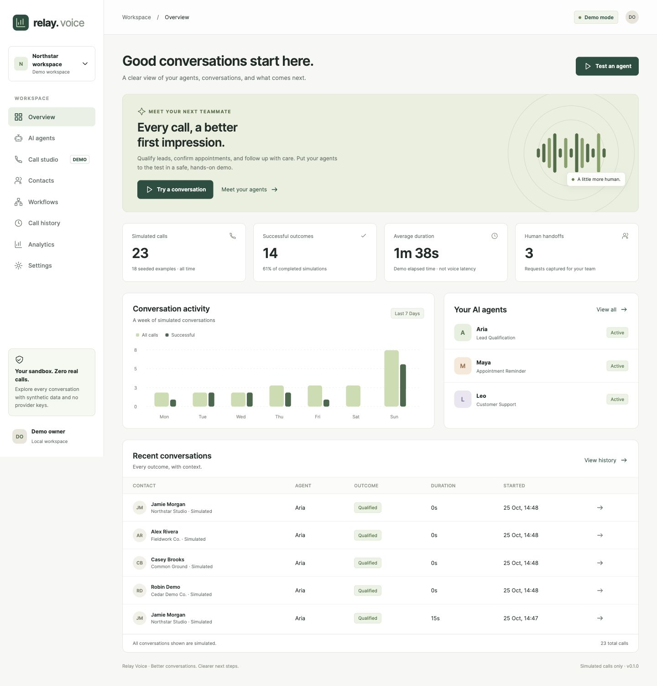

# Relay Voice

**A separate, local AI calling product demo built from an audited voice-system foundation.**

Configure agents, manage contacts, hold browser voice conversations, rehearse scripted flows, review transcripts, and see the next step. The dashboard uses a real API and SQLite persistence. Gnani Prisma/Timbre provides streaming speech with Bifrost for conversation; the former AssemblyAI/ElevenLabs path remains configurable. Telephone dialing remains unavailable. See [Gnani setup](docs/GNANI-DEMO.md) and [automatic interruption and session memory](docs/BARGE-IN-MEMORY.md).

The browser runtime supports English, Hindi and Hinglish. Demo experiences includes sales, a business helper, customer care and appointment intake. Each has its own instructions and business context.

## Public site

The 60-second hackathon film has a reproducible Remotion pipeline under [`video/`](video/README.md). It captures the real application in a separate fictional recording workspace and uses the configured Gnani/Bifrost providers. Render and review commands are documented there; generated media stays outside Git.

The static product site is deployed from `site/` to [GitHub Pages](https://solmyst.github.io/calling-sas/). GitHub Pages cannot run FastAPI, SQLite, private API keys or realtime server WebSockets; use the deployment configuration in `deploy/` for the working voice application.



## Start locally

Python 3.14 was used and tested on this Mac. No Node build, Docker or telephony account is needed. Typed simulation works without provider credentials; browser voice requires the settings below.

```sh
cd "/Users/anushgupta/Documents/Codex/2026-10-25/i-m-providing-you-with-the/outputs/relay-voice"
./scripts/start.sh
```

Open **http://127.0.0.1:8787**. Stop with Ctrl+C. The script creates an isolated `.venv` and installs the pinned lockfile if the venv is absent. On a different machine, change the `cd` path to your checkout.

Manual clean setup:

```sh
python3 -m venv .venv
.venv/bin/python -m pip install -r requirements.lock
cp .env.example .env
.venv/bin/python run.py
```

Configuration is optional locally. A local `.env` is ignored by Git. Shell environment variables take precedence. Set `PORT` and `PUBLIC_ORIGIN` together when changing the port. If the port is in use, use another port; do not stop an unrelated process. Local mode refuses a non-loopback bind address.

For browser voice, configure these server-only values in `.env` and restart:

```dotenv
SPEECH_PROVIDER=gnani
GNANI_API_KEY=
GNANI_STT_MODEL=prisma-v3.0
GNANI_TTS_MODEL=timbre-v3.0
GNANI_VOICE=Shivani
GNANI_AUDIO_TAGS=false
BIFROST_URL=https://bifrost.parkplus.io/v1
BIFROST_VK=
BIFROST_MODELS=your-approved-model-id
```

The current local `.env` has been configured from the provider credentials the user explicitly authorized for this demo. It is mode `0600` and Git-ignored. Keys never enter frontend JavaScript or API responses.

## Your five-minute pitch

1. Open **Demo experiences** and choose a scenario relevant to the prospect.
2. Customize the agent's business facts, language, delivery and opening.
3. In **Call studio**, choose Live browser voice, start and approve microphone access. Speak at any time to interrupt; Silero stops the AI, Gnani recognizes your words, and session memory preserves details and corrections.
4. Try an unexpected question or correct an appointment preference. End the session and review the saved transcript and follow-up request together.
5. Explain the next step honestly: a booking request needs availability verification; a handoff needs a person. No external action is executed.
6. Agree on one pilot workflow and a measurable outcome. History and analytics reflect actual stored browser sessions and labelled typed simulations, not fabricated sales results.

An in-progress conversation survives page/server restarts; open it from Call history and select Resume. The runtime database lives in `runtime/relay.sqlite` by default. Keep the entire `runtime` directory private. To start an independent fresh demo, set DATABASE_PATH to a new file; do not delete a database containing wanted work.

## Included features

| Area | Working locally |
|---|---|
| Dashboard | Persisted call totals, outcomes, demo duration, weekly activity, agents, recent calls |
| Agents | Create/edit, pause, industry/use case, opening, question, context, prompt storage |
| Contacts | Create/edit, search, segments, E.164 validation, consent and do-not-call enforcement |
| Studio | Typed simulation plus browser voice: Gnani streaming STT/TTS, Bifrost LLM, exact PCM capture and reply timing |
| Workflows | Create/edit/pause, segment selection, batch simulation, request deduplication, local tasks |
| History | Search/filter, transcript viewer/export, configuration snapshots, resume active simulations |
| Analytics | Derived all-time and weekly metrics; no invented production claims |
| Privacy | Original redactor reused, extra email masking, escaped rendering, no frontend credentials |
| Operations | Environment settings, optional local password, hosted-mode gates, backup tool, VM templates |

No fabricated activity history is seeded. Typed simulations and batch runs use scripted responses and may show 0s durations. Browser voice invokes configured cloud providers and saves generated transcript text; it does not store raw microphone recordings. Synthetic smoke-test audio is written only by the explicitly invoked check script under ignored `runtime/`. No real calendar booking, actual transfer, SMS, WhatsApp, email, Exotel call or external CRM update occurs.

## Tests

```sh
.venv/bin/python -m unittest discover -s tests -v
node --check static/app.js
node --check static/views.js
node --check static/forms.js
```

Node is needed only for optional JS syntax checks, not for running the product. Tests use temporary databases and no external services. See [verification report](docs/VERIFICATION.md) for browser checks, fixes and limitations.

## Independence and reuse

The original `/Users/anushgupta/Documents/Ai calling work/` project was inspected read-only. Nothing in the new app imports it or requires its files at runtime. The user confirmed permission to reuse code and later explicitly authorized the provided provider accounts for this demo. The selected AssemblyAI, Bifrost and ElevenLabs settings were copied into the standalone product's private, ignored `.env`; no customer data, recordings, company business prompts or telephony/messaging credentials were copied.

The original voice engine contains useful failover and lifecycle behavior, but also direct company integrations. The audit and architecture document explain how to preserve that investment in a separate media worker, rather than importing the company monolith into the product.

## Documentation

- [Existing-system audit](docs/SOURCE-AUDIT.md) and [symbol inventory](docs/source-inventory.json)
- [Product context and acceptance criteria](docs/PRODUCT.md)
- [Architecture, storage and provider boundary](docs/ARCHITECTURE.md)
- [Feature overview and pitch guide](docs/DEMO-GUIDE.md)
- [VM deployment preparation](docs/DEPLOYMENT.md)
- [Roadmap and commercial release gates](docs/ROADMAP.md)
- [Reuse provenance](docs/PROVENANCE.md)
- [Voice integration and test plan](docs/VOICE-INTEGRATION.md)
- [Sales demo prompt](docs/SALES-DEMO-PROMPT.md)
- [Initial commercial plan](docs/GO-TO-MARKET.md)

## Release status

**Local browser voice demo, v0.2.0.** Provider connectivity and synthetic round-trip audio have been verified. The physical microphone flow still needs the operator to grant permission and speak. This is not a production multi-tenant SaaS or a validated telephone calling service. Exotel, real customer data and hosting remain later stages. Nothing has been deployed.
